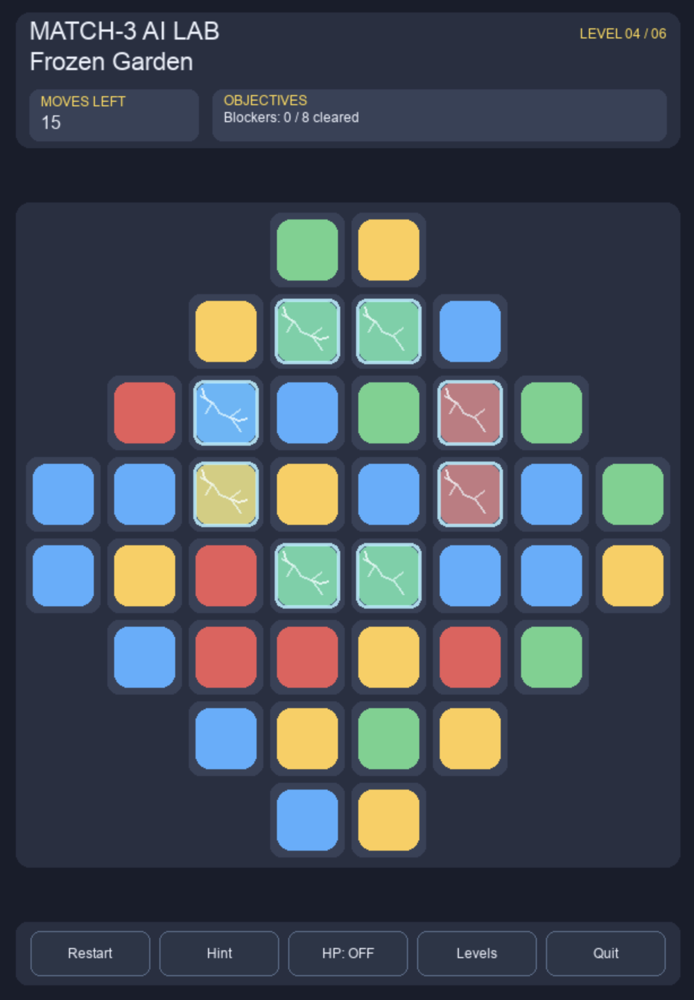
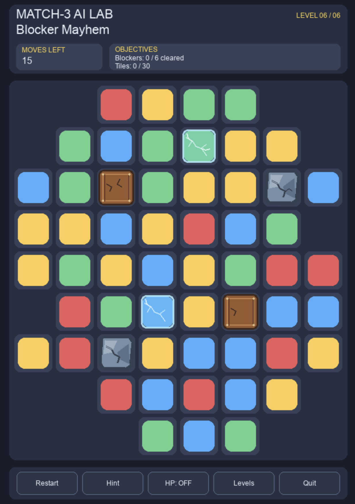

# Match-3 AI Lab

I built a playable Match-3 game in Python to experiment with reinforcement learning and gameplay data analysis.

The idea started with a simple question: **Can an AI agent learn to play Match-3 better than a rule-based strategy?**

I developed the game engine, introduced different level mechanics, trained AI agents, and analyzed gameplay data to understand what makes certain levels more challenging.

## The Game

The game includes six playable levels with different board layouts, objectives, and obstacles.

Features include:
- Match detection, cascades, and special tiles
- Wooden, frozen, and stone blockers
- Different board shapes and level objectives
- Move limits and win/loss conditions
- A playable Pygame interface

| Frozen Garden | Blocker Mayhem |
|---|---|
|  |  |

## AI Agents

I implemented and evaluated five agents:

- **Random:** Selects a random valid move.
- **Greedy:** Uses a rule-based strategy to select moves.
- **DDQN:** Learns action values through reinforcement learning.
- **PPO:** Learns a policy using an actor-critic approach.
- **Stochastic MCTS:** Plans each move with open-loop tree search and sampled future refills, without training a policy.

Random and Greedy choose from the current board; DDQN and PPO use trained networks. MCTS instead spends a configurable simulation budget exploring future play on independent copies of the environment. It builds a fresh tree for each decision, uses UCT for selection, and backs up terminal or outcome-based values. The most-visited root action is selected; this finite search does not guarantee an optimal move.

### Evaluation Results

The Random, Greedy, DDQN, and PPO comparison below uses 100 paired episodes per level.

| Level | Random | Greedy | DDQN | PPO |
|---|---:|---:|---:|---:|
| Double Trouble | 62% | 64% | **77%** | 58% |
| Wooden Trouble | 43% | 32% | **63%** | 51% |
| Frozen Garden | 48% | 54% | **76%** | 66% |
| **Macro average** | **51.0%** | **50.0%** | **72.0%** | **58.3%** |

DDQN achieved the highest observed win rate across all three evaluated levels.

These results describe the selected trained policies on a limited evaluation set. They do not establish statistical superiority across other levels or training runs.

Stochastic MCTS has a separate paired benchmark on the calibrated V2 levels.
Its four-way rollout/value ablation, reproducible commands, source-provenance
checks, and computational limits are documented in
[Stochastic MCTS](docs/stochastic_mcts.md). Those results use different evaluation
settings from the RL table above and should be interpreted separately.

MCTS also provides an agent-based level evaluation: paired win rates, objective completion, and winning moves describe difficulty under a specified agent, simulation budget, and seed set. These AI estimates are not measurements of human-perceived difficulty.

## Gameplay Data Analysis

I also explored gameplay data to understand how board characteristics and agent behavior relate to winning.

The analysis includes:
- Exploratory data analysis
- Paired statistical comparisons
- Feature engineering from board states
- Win prediction using Logistic Regression and Random Forest
- Spatial feature experiments and grouped cross-validation

Adding spatial features improved mean cross-validated ROC-AUC from **0.577 to 0.591**, although probability calibration metrics did not improve.

For the methodology, detailed results, and limitations, see the [Results & Analysis Report](docs/RESULTS.md).

## Getting Started

Use Python **3.11** (recommended). From the repository root:

```bash
python3.11 -m venv .venv
source .venv/bin/activate              # Windows: .venv\Scripts\activate
python -m pip install --upgrade pip
python -m pip install -e ".[rl,ui,analysis,dev]"
python -m pip check
```

PyTorch installation depends on your operating system and accelerator. The `rl` extra installs a compatible PyTorch release; for CUDA-specific wheels, consult the official PyTorch installation instructions. The first installation requires network access.

Launch the game:

```bash
python -m match3_ai.ui.pygame_view --levels
```

Run the test suite (from the repository root):

```bash
python -m pytest -q
```

### Reproducing experiments

The following commands use the installed package and should be run **from the repository root**. Outputs are written to new directories; avoid reusing an existing output directory.

**1. Re-run a Random vs. Greedy baseline experiment** (100 episodes per agent/level with fixed seeds):

```bash
python -m match3_ai.evaluation.benchmark \
  --episodes 100 --env-seed 52000 --agent-seed 93000 \
  --output-dir experiments/results/readme_baseline_52000
```

This regenerates baseline evaluation records, **not** the DDQN/PPO win-rate table above. The latter uses specific validation-selected trained checkpoints and a separate paired evaluation protocol.

**2. Run short RL training smoke experiments** (not the published training budget):

```bash
python -m match3_ai.training.dqn --level-id blocker-mayhem \
  --steps 1000 --seed 5700 --output-dir experiments/results/readme_dqn_smoke
python -m match3_ai.training.ppo --help
```

These commands verify that the training entry points are available; the short DQN run will not reproduce the published DDQN results. Use `--help` on an entry point to inspect its supported arguments before launching longer runs.

**3. Inspect the gameplay analysis**:

The committed `analysis/data/stage2_ml_dataset.csv` and numbered scripts under `analysis/` document the data-science workflow. Start with:

```bash
python analysis/01_data_understanding.py
```

Some analysis scripts consume intermediate files generated by earlier stages. Review their input paths before running later scripts.

**4. Compare MCTS with Random and Greedy** (small development benchmark):

```bash
python scripts/benchmark_mcts_baselines.py \
  --episodes 2 --simulations 30 \
  --env-seed-start 10002000 --agent-seed-start 20020000 \
  --output-dir results/readme_mcts_smoke
```

This runs Random, Greedy, random-rollout/terminal-value MCTS, and greedy-rollout/outcome-value MCTS on the three calibrated V2 levels, using paired initial boards. `--episodes` is per agent per level: this example runs 24 episodes. Results are saved incrementally to `episodes.csv`, `summary.csv`, and `manifest.json`; an existing output directory is rejected. See the [MCTS guide](docs/stochastic_mcts.md) for all four rollout/value configurations, confidence intervals, provenance checks, and completed benchmark artifacts. MCTS simulates games to termination, so even small benchmarks can take minutes.

**Reproducibility scope:** The published RL comparison in [Results & Analysis](docs/RESULTS.md) relies on validation-selected DDQN/PPO checkpoints and the original evaluation configuration. These trained checkpoint artifacts are **not included in this source archive**, so the exact reported RL win rates cannot be reproduced from a fresh clone using only the commands above. Baseline runs and new training runs are reproducible experiments, but should not be represented as reproductions of that table. Software/hardware differences may also affect training outcomes.

## Tech Stack

Python · NumPy · PyTorch · Gymnasium · Pygame · Matplotlib · pytest

The game engine, AI agents, evaluation tools, and UI are kept separate so that gameplay mechanics can be tested independently of rendering and training.
