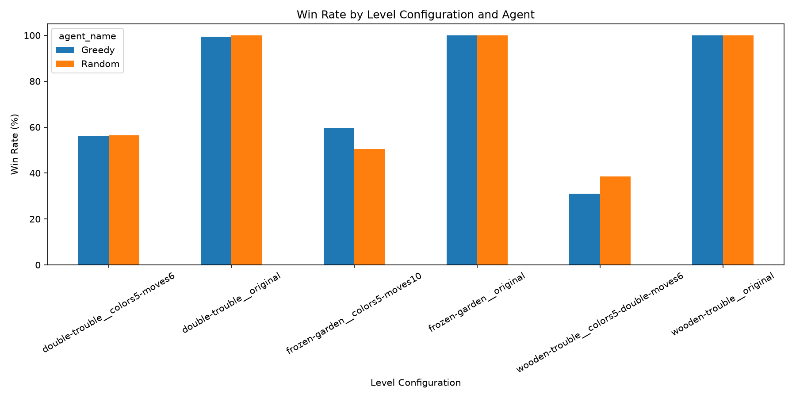
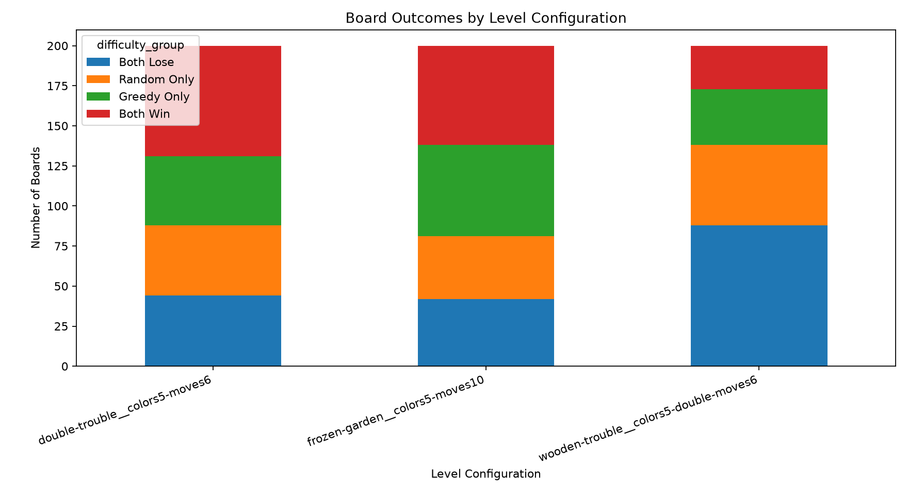
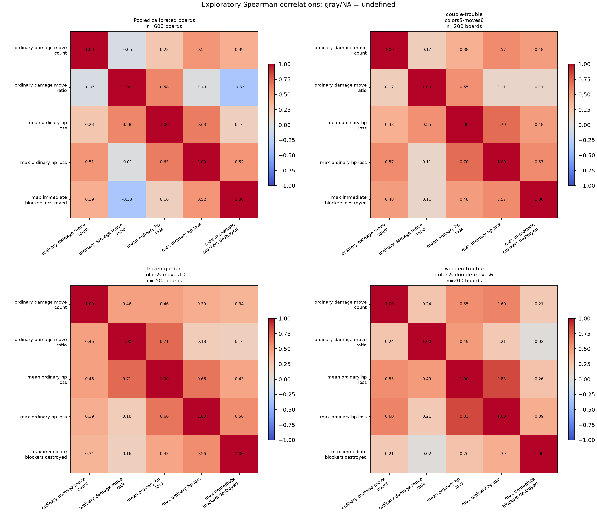

# Results & Analysis

Match3-AI-Lab evaluates reinforcement learning, stochastic tree search, neural-guided search, and gameplay analytics. **Each study uses a separate evaluation protocol; win rates across studies are not directly comparable.**

## 1. Reinforcement Learning

### Method

Random, Greedy, Double DQN (DDQN), and PPO were evaluated on three levels using **100 paired episodes per agent per level**. Trained checkpoints were selected during validation.

### Results

| Level | Random | Greedy | DDQN | PPO |
|:--|--:|--:|--:|--:|
| Double Trouble | 62% | 64% | **77%** | 58% |
| Wooden Trouble | 43% | 32% | **63%** | 51% |
| Frozen Garden | 48% | 54% | **76%** | 66% |
| **Macro average** | **51.0%** | **50.0%** | **72.0%** | **58.3%** |

**Finding:** DDQN achieved the highest observed win rate on all three levels. These results do not establish superiority on unseen levels or across training budgets.

## 2. Classic Monte Carlo Tree Search

### Method

Classic MCTS uses **stochastic open-loop UCT**: it clones the environment, samples game outcomes, and evaluates candidate actions through rollouts. The evaluation used **100 paired boards per level** and **30 simulations per decision**.

| Variant | Rollout policy | Value function |
|:--|:--|:--|
| RT | Random | Terminal |
| RO | Random | Outcome |
| GT | Greedy | Terminal |
| GO | Greedy | Outcome |

### Baseline comparison

| Level | Random | Greedy | MCTS (RT) | MCTS (GO) |
|:--|--:|--:|--:|--:|
| Double Trouble V2 | 52% | 55% | 91% | **93%** |
| Wooden Trouble V2 | 41% | 37% | **95%** | 93% |
| Frozen Garden V2 | 52% | 64% | 94% | **95%** |

[Baseline benchmark records](benchmarks/mcts_baselines_main_100/summary.csv)

### Rollout and value ablation

| Level | RT | RO | GT | GO |
|:--|--:|--:|--:|--:|
| Double Trouble V2 | 91% | 93% | 91% | 93% |
| Wooden Trouble V2 | 95% | 92% | 94% | 93% |

The complete three-level ablation is available in the [ablation benchmark records](benchmarks/mcts_ablation_100/summary.csv).

**Finding:** MCTS substantially outperformed Random and Greedy on these development boards. Small differences among MCTS variants are not conclusive, and search incurs additional computational cost.

## 3. Neural Monte Carlo Tree Search

### Method

An AlphaZero-inspired agent combines **PUCT search** with a CNN policy-value network. Training uses search-visit distributions as policy targets and terminal wins/losses as value targets. The single-player search does not flip value signs during backup.

The evaluation used **20 paired boards per Medium and compatible Hard configuration**, with **8 simulations per decision**.

### Results

| Agent | Medium win rate | Hard win rate |
|:--|--:|--:|
| Random | 0% | 0% |
| Greedy | 30% | 0% |
| **Classic MCTS** | **70%** | **30%** |
| Neural MCTS (untrained) | 10% | 0% |
| Neural MCTS (trained) | 30% | 0% |

**Finding:** Training improved the observed Medium result from 10% to 30%, but Neural MCTS did not outperform Classic MCTS.

**Limitations:** All **5,352 training episodes** ended in wins, providing little variation in value targets. The final value network predicted **+1 on all 50 inspected evaluation boards**. The Hard evaluation used a five-color compatible configuration because the accepted six-color level exceeded the encoder's supported range. These are small development-set comparisons, not independent final-test results.

[Neural MCTS evaluation details](benchmarks/az4/evaluation_findings.md)

## 4. Gameplay Analytics

### Paired statistical analysis

The dataset contains **2,400 gameplay episodes** generated by Random and Greedy agents. Agent comparisons used **200 matched boards per level**, exact two-sided McNemar tests, and Holm correction. Confidence intervals are paired bootstrap intervals.

| Level | Greedy − Random | 95% CI (pp) | Holm-adjusted p |
|:--|--:|:--:|--:|
| Wooden Trouble V2 | −7.5 pp | [−16.5, +1.5] | 0.2568 |
| Double Trouble V2 | −0.5 pp | [−9.5, +8.5] | 1.0000 |
| Frozen Garden V2 | +9.0 pp | [−0.5, +18.5] | 0.2466 |

**Finding:** No paired win-rate difference was statistically significant after correction. Non-significance does not establish equivalence.

### Win prediction

| Model | Accuracy | ROC-AUC | PR-AUC |
|:--|--:|--:|--:|
| Historical baseline | **0.608** | 0.625 | 0.582 |
| Logistic Regression | 0.604 | **0.647** | **0.623** |
| Random Forest | 0.558 | 0.606 | 0.605 |

**Finding:** Logistic Regression achieved the highest ROC-AUC and PR-AUC; the historical baseline had slightly higher accuracy.

### Spatial feature engineering

Grouped cross-validation assessed whether spatial board features improved win prediction.

| Feature set | Mean ROC-AUC | Mean PR-AUC |
|:--|--:|--:|
| Level + Agent | 0.577 | 0.525 |
| Level + Agent + Board | 0.584 | 0.539 |
| Level + Agent + Spatial | **0.591** | 0.556 |
| Level + Agent + Board + Spatial | 0.583 | **0.557** |

**Finding:** Spatial features modestly improved ranking metrics but did not improve probability calibration.

### Visualizations

**Agent win rates**

**Board difficulty distribution**

**Spatial feature correlations**

## 5. Key Takeaways

| Area | Main observation |
|:--|:--|
| Reinforcement learning | DDQN led the evaluated three-level comparison. |
| Classic MCTS | Search substantially improved win rates on the tested V2 boards. |
| Neural MCTS | Limited training diversity restricted value learning and generalization. |
| Statistical testing | Greedy–Random differences were not significant after correction. |
| Predictive modeling | Logistic Regression led ROC-AUC and PR-AUC; spatial features added modest ranking gains. |

The project demonstrates automated playtesting and data-driven evaluation, while highlighting the importance of representative training tasks, paired experiments, and careful interpretation of results.
